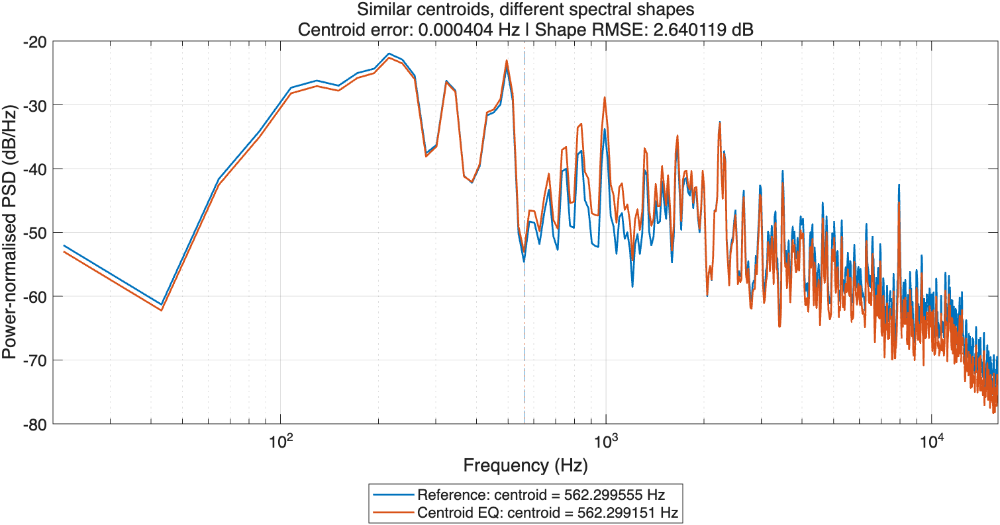
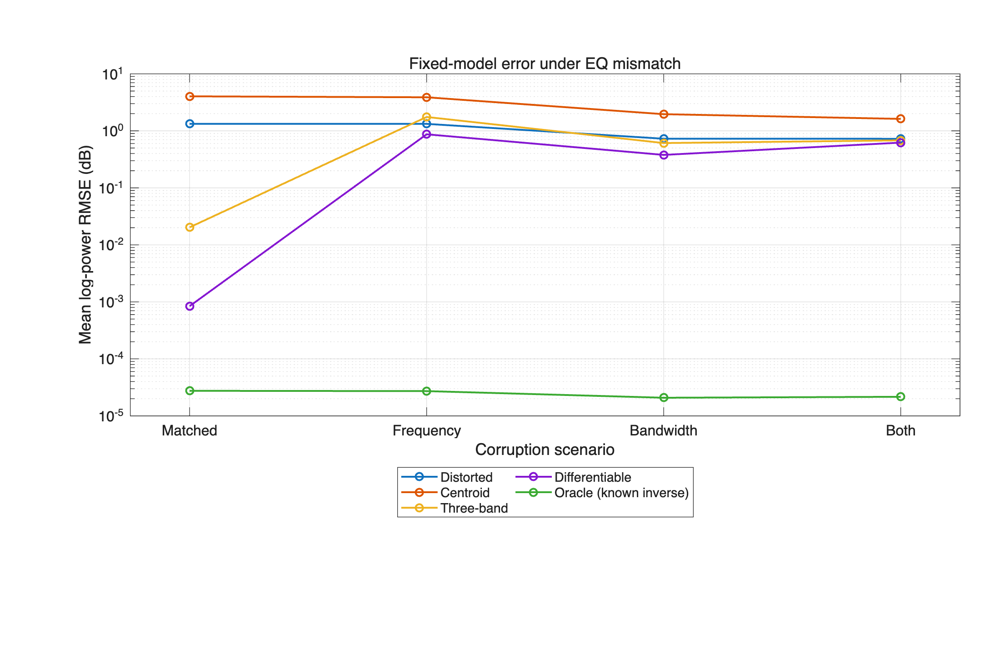

# Is Spectral Centroid Enough?

## Interpretable versus Differentiable Automatic Equalisation

**ELEC5305 final project — Yishu Zhang, 540995787**

The research question is whether matching one spectral centroid can recover an EQ-distorted signal, compared with using three band powers or a detailed log-power spectrum. The code compares these objectives on controlled guitar recordings, then tests content dependence, equal processor capacity, and filter-model mismatch.

[Code repository](https://github.com/Elena0129/elec5305-final-project-540995787) · [Results](results/) · [Earlier project](https://github.com/Elena0129/elec5305-project-540995787)

The project website is prepared in `index.html`. Its GitHub Pages address will be <https://elena0129.github.io/elec5305-final-project-540995787/> after Pages is enabled. The final report PDF and demonstration video links will be added after their final upload; a repository URL is not a video URL.

## Requirements

The original Live Script records **MATLAB R2025b**. Required products are MATLAB, Audio Toolbox, Signal Processing Toolbox and Deep Learning Toolbox, including their installed dependencies. Fitting runs on the CPU; a GPU and a pretrained network are not required.

`project_param_eq.m` handles the documented `designParamEQ` interface change in R2026a while keeping the same second-order filter, gain, normalised frequency and bandwidth. Run `check_project` on the installed release before starting the demonstration. The compatibility change still needs local execution on each release being used.

## Quick start

1. Clone or download this repository, including `data/` and `results/`.
2. Open MATLAB and make the repository root, containing this README, the Current Folder.
3. Run the plain script:

   ```matlab
   run('run_project_demo.m')
   ```

   Alternatively, open `Step01_prepare_audio.mlx` and select **Run All**. Both files contain the same executable sections; either entry is sufficient.

The script checks the required files and toolboxes, reuses the supplied pilot excerpts, creates the high-shelf and mid-cut pilot distortions, fits the centroid and three-band corrections, and fits the differentiable correction on the same mid-cut pair. It produces spectra, gain searches, convergence plots and a four-method pilot comparison. Desktop playback includes the reference and high-shelf-distorted audio; set `playAudio` to `false` in the first section to skip playback.

The later sections **load the saved formal experiments**. They do not refit every formal test pair. The final verification restores one omitted output WAV from its recorded gain, then remeasures that example and checks agreement with its saved metrics. Restoring a saved processor is distinct from a new optimisation run.

The supplied data are enough for this demonstration and for the formal experiments. The full `data/raw` download is optional.

## Independent checks

Check prerequisites and saved table dimensions:

```matlab
check_project("demo")
```

Check the prepared data and saved tables without the filter/autodiff probes:

```matlab
check_project("saved")
```

Run the regression checks for moved-project paths and the peaking-filter interface:

```matlab
testResults = runtests('tests');
assert(all([testResults.Passed]), 'A regression check failed.');
```

These checks validate their stated prerequisites and invariants. They do not establish listening quality or replace a fresh run of the complete benchmark.

## Reproduce all formal experiments

For a fresh fit of the five experiment modules, run:

```matlab
report = reproduce_results(false);
```

This runs the following stages in dependency order:

| Stage | Function | Work performed |
| --- | --- | --- |
| 1 | `run_batch_comparison(false)` | Create the controlled inputs, fit A/B/C, save and remeasure the output WAVs |
| 2 | `run_extended_evaluation` | Remeasure raw, level-controlled shape and multi-resolution errors; calculate performer-cluster intervals |
| 3 | `run_content_dependence("run")` | Compare self-reference and a fixed pilot-derived centroid target on clean test excerpts |
| 4 | `run_capacity_ablation("run", false)` | Fit a spectral objective with the same one-shelf processor as the centroid baseline |
| 5 | `run_model_mismatch("run", false)` | Test shifted peaking frequency/bandwidth and a known-inverse diagnostic |

The wrapper also regenerates the formal figures. This is substantially slower than the pilot demonstration and creates roughly the original 1.5 GB of derived result files. It updates tables, timings, MAT files and figures in the current checkout. Fitting times depend on the computer, MATLAB release and warm-up state.

The `false` argument starts fresh, avoiding checkpoints that were produced on another computer or with earlier code. To resume an interrupted, unchanged run made in the **same checkout**, use:

```matlab
report = reproduce_results(true);
```

Checkpoint signatures deliberately reject changed source code, settings or reference file metadata. A completed checkpoint is not a substitute for output WAVs that have been omitted from a download.

## Data and output files

| Location | Contents |
| --- | --- |
| `data/pilot/` | Three five-second reference excerpts, source manifest, pilot distortions and listening examples |
| `data/batch/reference/` | Thirty prepared five-second, mono, 44.1 kHz test references |
| `data/batch/distorted/` | Eight controlled EQ conditions for each reference: 240 inputs |
| `data/batch/manifest.csv` | Pair IDs, source reference paths, conditions and corruption gains |
| `data/batch/references.csv` | Source filenames, performer IDs, crop samples and scaling factors |
| `data/batch/protocol.mat` | Filter and spectral-analysis settings |
| `results/` | Recorded CSV metrics, figures, settings and saved reports |

The historical CSV and MAT files can contain paths from the original Mac. `project_audio_path.m` resolves their `data/` and `results/` suffixes inside the current checkout, even when the old project still exists elsewhere. It reports missing local files rather than silently mixing two project copies.

Large, generated **result WAVs** are omitted from version control. The pilot listening examples remain included. To rebuild a selected benchmark output from its recorded gains without fitting again:

```matlab
restore_benchmark_audio("clip_005_mid_boost", "Centroid");
```

To reconstruct all three corrected benchmark outputs for one pair, or for every pair:

```matlab
restore_benchmark_audio("clip_001_mid_cut");
restore_benchmark_audio("all");
```

Each newly created WAV is remeasured against the recorded raw spectrum and centroid errors. To rerun `run_extended_evaluation` on the recorded processors, first restore all their WAVs. A fresh fit instead uses `reproduce_results(false)`.

### Original recordings

The excerpts are derived from **GuitarSet** [8], using the mono microphone recordings. The source authors are Qingyang Xi, Rachel M. Bittner, Johan Pauwels, Xuzhou Ye and Juan P. Bello. Dataset download and reuse information are available in the [official GuitarSet record, version 1.1.0](https://zenodo.org/records/3371780).

For optional preparation from the original recordings, download `audio_mono-mic.zip` from that record and extract its WAV files beneath `data/raw/`. `prepare_pilot_audio(true)` implements the three-pilot selection and preparation; `prepare_batch_dataset` implements the seeded, performer-balanced formal selection after excluding pilot source recordings. They write preparation metadata. Use the supplied excerpts and manifests when reproducing the reported selection; a different input collection can select different recordings.

Preparation converts to mono, removes the DC offset, takes a centred five-second excerpt, scales the peak to 0.2 for the pilot and 0.1 for the formal references, and saves 24-bit WAV files. The formal set contains 30 distinct recordings, five per performer, with no pilot/test source-recording overlap. Performers are shared across development and final sets; this is not a performer-held-out generalisation study.

## Methods and evaluation

| Method | Target information | Adjustable processor |
| --- | --- | --- |
| A: Centroid | One power spectral centroid | One high-shelf gain at 2500 Hz |
| B: Three-band | Powers in 20–500, 500–2000 and 2000–16000 Hz | Low shelf, peaking section and high shelf |
| C: Differentiable | Detailed log-power spectrum over 20–16000 Hz | The same three gains, bounded by `12*tanh(theta)` |

The shared three-section model uses 250, 1000 and 2500 Hz, a 1000 Hz peaking bandwidth, and shelf slope 1. Method C uses automatic differentiation and Adam with learning rate 0.03 and at most 400 iterations. It optimises three gains separately for each input/reference pair; it does not train a neural network across recordings. The fitters are not given the known corruption gains.

Welch analysis uses a periodic 2048-sample Hann window, 1024-sample overlap and 2048-point FFT. The controlled inputs use ±6 dB single-section changes and two mixed conditions. The target reference is available to every correction method. This is an offline, reference-based restoration experiment, not blind mastering or real-time adaptation.

Raw log-power RMSE, power-level-controlled shape RMSE, and multi-resolution log-magnitude error are reported separately. The latter uses FFT lengths 512, 2048 and 8192. Confidence intervals resample the six performer clusters, with 2000 bootstrap samples and seed 5305. Power matching is an analysis control, not perceptual loudness normalisation. No listening-quality claim is inferred from these metrics.

## Recorded results

The mean formal results below come from the supplied experiment CSV files. All four rows use the same 240 test pairs.

| Method | Centroid error (Hz) | Raw RMSE (dB) | Shape RMSE (dB) | MR log-magnitude RMSE (dB) |
| --- | ---: | ---: | ---: | ---: |
| Distorted | 163.159985 | 3.167138 | 3.361678 | 2.383855 |
| A: Centroid | 7.882010 | 4.549816 | 3.685349 | 2.217727 |
| B: Three-band | 0.742357 | 0.017420 | 0.016942 | 0.012580 |
| C: Differentiable | 0.329024 | 0.001708 | 0.005018 | 0.004340 |

Centroid matching can succeed on the centroid while leaving substantial spectral error. It also performs very well when the distortion matches its high-shelf processor. B and C recover the matched three-section distortions more accurately overall, but their advantage decreases when the corruption frequency or bandwidth differs from the fixed correction model. The matched-capacity ablation separates the fitting objective from the number of adjustable gains.





| Experiment | Saved result rows |
| --- | ---: |
| Formal benchmark | 960 |
| Extended evaluation of the same benchmark | 960 |
| Content dependence | 60 |
| Matched-capacity ablation | 960 |
| Model mismatch | 1200 |

These are comparison rows with repeated conditions and methods, not independent recordings. The extended evaluation remeasures the formal benchmark; it does not add 960 new audio excerpts.

## Listening examples

Use the same pilot reference and mid-cut distortion for these comparisons:

- [Reference](data/pilot/reference_01.wav)
- [Distorted: −6 dB mid-frequency cut](data/pilot/distorted/reference_01_peaking_-6dB.wav)
- [A: Centroid correction](data/pilot/corrected/reference_01_midcut_centroid_corrected.wav)
- [B: Three-band correction](data/pilot/corrected/reference_01_midcut_multiband_corrected.wav)
- [C: Differentiable correction](data/pilot/corrected/reference_01_midcut_differentiable_corrected.wav)

## References

These are academic publications. Software documentation and dataset download links are listed separately below.

1. V. Välimäki and J. D. Reiss, “All About Audio Equalization: Solutions and Frontiers,” *Applied Sciences*, vol. 6, no. 5, article 129, 2016. [DOI](https://doi.org/10.3390/app6050129).
2. J. Engel, L. Hantrakul, C. Gu and A. Roberts, “DDSP: Differentiable Digital Signal Processing,” *ICLR*, 2020. [Paper](https://openreview.net/forum?id=B1x1ma4tDr).
3. S. Nercessian, “Neural Parametric Equalizer Matching Using Differentiable Biquads,” *DAFx*, 2020, pp. 265–272. [Paper](https://www.dafx.de/paper-archive/2020/proceedings/papers/DAFx2020_paper_7.pdf).
4. G. Pepe, L. Gabrielli, S. Squartini, C. Tripodi and N. Strozzi, “Deep Optimization of Parametric IIR Filters for Audio Equalization,” *IEEE/ACM TASLP*, vol. 30, pp. 1136–1149, 2022. [DOI](https://doi.org/10.1109/TASLP.2022.3155289).
5. F. Mockenhaupt, J. S. Rieber and S. Nercessian, “Automatic Equalization for Individual Instrument Tracks Using Convolutional Neural Networks,” *DAFx*, 2024. [Paper](https://www.dafx.de/paper-archive/2024/papers/DAFx24_paper_27.pdf).
6. P. Sarkar and P. Lindborg, “Neural-Driven Multi-Band Processing for Automatic Equalization and Style Transfer,” *DAFx*, 2025, pp. 382–389. [Paper](https://dafx.de/paper-archive/2025/DAFx25_paper_81.pdf).
7. C.-Y. Yu et al., “DiffVox: A Differentiable Model for Capturing and Analysing Vocal Effects Distributions,” *DAFx*, 2025. [Paper](https://dafx.de/paper-archive/2025/DAFx25_paper_9.pdf).
8. Q. Xi, R. M. Bittner, J. Pauwels, X. Ye and J. P. Bello, “GuitarSet: A Dataset for Guitar Transcription,” *ISMIR*, 2018, pp. 453–460. [Paper](https://archives.ismir.net/ismir2018/paper/000188.pdf).
9. P. D. Welch, “The Use of Fast Fourier Transform for the Estimation of Power Spectra: A Method Based on Time Averaging over Short, Modified Periodograms,” *IEEE Transactions on Audio and Electroacoustics*, vol. 15, no. 2, pp. 70–73, 1967. [DOI](https://doi.org/10.1109/TAU.1967.1161901).
10. D. P. Kingma and J. Ba, “Adam: A Method for Stochastic Optimization,” *ICLR*, 2015. [Paper](https://arxiv.org/abs/1412.6980).

### Implementation resources

- [MathWorks: `designParamEQ`, including the R2026a interface change](https://www.mathworks.com/help/audio/ref/designparameq.html)
- [MathWorks: `designShelvingEQ`](https://www.mathworks.com/help/audio/ref/designshelvingeq.html)
- [MathWorks: automatic differentiation with `dlgradient`](https://www.mathworks.com/help/deeplearning/ref/dlarray.dlgradient.html)
- [Official GuitarSet download and dataset information](https://zenodo.org/records/3371780)
